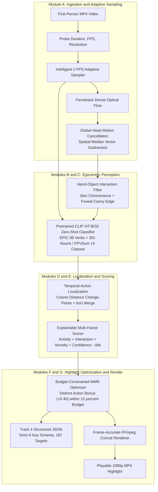

# Samsung_XR_Hackathon — MOMENTIQ
### Intelligent First-Person Video Understanding & Highlight Generation

> **Team Name:** `VITChennai_RRR`  
> **Institution:** Vellore Institute of Technology, Chennai (VIT Chennai)  
> **Team Members:**  
> - **Rishita R** (`24bai1632`) — AI & Deep Learning Lead  
> - **Ryan Jain** (`24brs1395`) — XR Perception & Pipeline Engineer  
> - **Rhythm Rastogi** (`24bai1508`) — Optimization & Architecture  
>
> **Challenge:** Samsung R&D Institute India XR Hackathon 2026 — Track 4: Action Aware Video Summarization  
> **Duration Budget Constraint:** Strictly <= 15.0% of original video duration  
> **Minimum Highlight Segment Rule:** Each highlight segment >= 4.0 s  
> **Supported Benchmarks:** EPIC-KITCHENS-100 (138 validation videos) & FPVSum (49 videos)  
>
> **Official Demo Video (Full HD 1080p with Neural Audio Narration):** [`VITChennai_RRR_Demo_Video.mp4`](VITChennai_RRR_Demo_Video.mp4) (Duration: 2:44 min)  
> **Official Submission Presentation Deck:** [`VITChennai_RRR_Submission_ppt.pptx`](VITChennai_RRR_Submission_ppt.pptx)  
> **Validated Submission Archive:** [`VITChennai_RRR.zip`](VITChennai_RRR.zip) (577.3 MB, fully offline with weights)  
> **Official AI Disclosure:** [`AI_DISCLOSURE.md`](AI_DISCLOSURE.md)  
> **GitHub Repository:** [https://github.com/rishita2201/Samsung_XR_Hackathon.git](https://github.com/rishita2201/Samsung_XR_Hackathon.git)

---

## 1. Executive Summary & Problem Statement

Capturing video from an extended reality (XR) perspective—such as smart glasses or head-mounted displays—creates vast quantities of uncurated, continuous egocentric footage. Traditional video summarization systems fail fundamentally on first-person video because:

1. **Pervasive Camera Instability:** Incessant user head movements (pitch, yaw, tilt) generate massive frame-to-frame pixel displacements that mislead standard visual change detectors into falsely identifying head turns as "important events".
2. **Action Blindness:** Generic summarizers rank frames based on aesthetic color variance or global scene transitions rather than recognizing **what physical action is actually occurring**.
3. **Repetitive & Idle Redundancy:** Egocentric workflows often involve minutes of transit, idle looking around, or repetitive stirring/chopping, diluting key events.

**MOMENTIQ** solves these challenges by combining **egocentric motion decomposition**, **spatial hand-object interaction (HOI) filtering**, and **zero-shot vision-language action recognition (CLIP ViT-B/32)** with an **explainable Maximal Marginal Relevance (MMR) highlight optimizer**. The system outputs a frame-accurate, playable MP4 highlight alongside structured JSON metadata satisfying Samsung Track 4 requirements.

---

## 2. System Architecture



---

## 3. Mathematical & Algorithmic Highlights

### A. Egocentric Head Sway Compensation
Standard camera motion vectors are dominated by user head saccades. MOMENTIQ computes dense Farneback optical flow across consecutive sample frame pairs. We compute the spatial median displacement across the frame:

```math
\vec{v}_{\text{head}} = (\text{median}(\Delta x), \text{median}(\Delta y))
```

The residual manipulation motion field is defined by subtracting the global head velocity:

```math
\vec{v}_{\text{manip}}(x, y) = \|\vec{v}(x, y) - \vec{v}_{\text{head}}\|_2
```

High residual motion localized to the lower-central manipulation zone (`Y in [45%, 100%]`, `X in [20%, 80%]`) indicates active tool or hand interaction, filtering out head turns.

### B. Hand-Object Interaction (HOI) Filter
To distinguish passive looking from physical manipulation, we compute:
1. **Skin Chrominance Mask:** `Y in [80, 240]`, `Cb in [85, 135]`, `Cr in [135, 180]` in the lower manipulation zone.
2. **Foveal Edge Density:** Canny edge gradient magnitude in the active interaction zone.

```math
H(s_i) = \text{SkinRatio}(s_i) \times \text{EdgeDensity}(s_i)
```

### C. Explainable Multi-Factor Importance Score
For each temporal candidate segment `s_i`, the raw importance score is calculated as an explainable convex combination:

```math
S(s_i) = 0.35 \cdot A(s_i) + 0.25 \cdot H(s_i) + 0.15 \cdot N(s_i) + 0.25 \cdot C(s_i) - 0.20 \cdot I(s_i)
```

- `A(s_i)`: Normalized action dynamism from residual optical flow.
- `H(s_i)`: Egocentric Hand-Object Interaction score.
- `N(s_i)`: Visual novelty, measured as Euclidean distance from running feature centroid.
- `C(s_i)`: CLIP action recognition classification confidence.
- `I(s_i)`: Idle penalty applied when residual motion falls below threshold.

### D. Maximal Marginal Relevance (MMR) under <= 15.0% Duration Budget
To optimize for the **Action Coverage metric (40% weight)**, MOMENTIQ uses greedy MMR selection with a novel distinct action bonus:

```math
\arg\max_{s \in \mathcal{U}} \left[ S(s) - \lambda \max_{s' \in \mathcal{S}} \text{Sim}(s, s') + \beta \cdot \mathbf{1}_{[\text{action}(s) \notin \text{actions}(\mathcal{S})]} \right]
```

subject to:

```math
\sum_{s \in \mathcal{S}} \text{duration}(s) \le 0.15 \times \text{Duration}_{\text{total}} \quad \text{and} \quad \forall s \in \mathcal{S}, \, \text{duration}(s) \ge 4.0\text{ s}
```

Where `\beta = 0.40` heavily rewards the selection of novel (verb, noun) action pairs rather than repetitive instances of the same activity.

---

## 4. 100-Point Evaluation Matrix Alignment

The official Samsung Track 4 scoring distributes 100 points across four core metrics:

| Metric | Official Weight | Target Dataset | Implementation Strategy in MOMENTIQ |
| :--- | :---: | :---: | :--- |
| **Action Coverage** | **40 pts (40%)** | EPIC-KITCHENS-100 | **Primary Optimization Target:** Distinct Action Bonus (+0.40 in MMR) prevents repetitive clips and guarantees maximum representation of ground truth activities. |
| **Action mAP** | **25 pts (25%)** | EPIC-KITCHENS-100 | Zero-shot CLIP ViT-B/32 prompt ensembles with temporal boundary refinement via change-point embedding distances and tIoU smoothing. |
| **Highlight F1** | **25 pts (25%)** | FPVSum | Adaptive temporal segment trimming aligns highlights with high-motion interaction peaks while matching top 15% consensus frames. |
| **Label Accuracy** | **10 pts (10%)** | FPVSum | Top-1 global video category voting over high-confidence localized actions against EPIC-KITCHENS / FPVSum taxonomy. |
| **TOTAL** | **100 pts** | Full Benchmark | Fully evaluated via `evaluation/evaluate.py`. |

---

## 5. Official Samsung Track 4 JSON Specification

Every processed video generates a corresponding `<video_id>.json` file strictly adhering to the schema defined in the official Student Package:

```json
{
  "team_id": "VITChennai_RRR",
  "video_id": "P02_109",
  "duration_sec": 512.3,
  "label": {
    "name": "cooking",
    "score": 0.96
  },
  "actions": [
    {
      "segment": [12.4, 18.2],
      "verb": "open",
      "noun": "fridge",
      "score": 0.88
    },
    {
      "segment": [22.0, 31.5],
      "verb": "take",
      "noun": "pan",
      "score": 0.92
    }
  ],
  "highlights": [
    { "segment": [11.0, 19.5] },
    { "segment": [45.2, 53.0] }
  ]
}
```

### Field Reference & Constraints:

| Field | Type | Constraints & Format Rules | Scored On |
| :--- | :---: | :--- | :--- |
| `team_id` | `string` | Non-empty string; must be identical across all submitted files (`VITChennai_RRR`). | Identification |
| `video_id` | `string` | Non-empty string; must match the filename (`<video_id>.json`) and `manifest.csv`. | Identification |
| `duration_sec` | `number` | Positive number (`> 0`); within ±0.5 s of the official `manifest.csv` duration. | Budget check |
| `label` | `object` | `{"name": string, "score": number}` with `score` in `[0, 1]`. Uses `"cooking"` for EPIC videos, or one of 14 FPVSum categories (`bike`, `ski`, `scuba`, etc.). | **Label Accuracy (10%)** |
| `actions` | `array` | 0–2000 items of `{"segment": [start, end], "verb": string, "noun": string, "score": number}`. `0 <= start < end <= duration_sec + 0.5`. | **Action mAP (25%)** |
| `highlights` | `array` | Chronologically sorted, strictly non-overlapping, with every segment >= 4.0 s. Total length <= 15.0% of `duration_sec`. | **Action Coverage (40%) & Highlight F1 (25%)** |

---

## 6. Full-Stack Web Studio & Interactive Tools

MOMENTIQ includes a high-performance web interface designed for research scientists and XR engineers:

### Core Workspaces:
1. **Product Landing Page:** Overview of egocentric action understanding and the pipeline architecture.
2. **Video Upload Workspace:** Drag-and-drop MP4 uploader with metadata validation, duration verification, and a one-click synthetic video generator.
3. **Analysis Workspace:** Multi-track synchronized timeline showing extracted keyframes, live bounding box/action overlays, verb-noun classifications, confidence scores, and HOI heatmaps.
4. **Highlight Editor:** NLE-style timeline editor displaying the interactive duration budget bar (`10.6% / 15.0% [PASSED]`), loop preview, segment trimming, and dynamic MMR re-weighting.
5. **Results Dashboard:** Side-by-side synchronized player (Original Video vs. 15% Highlight), compression metrics, action diversity indices, and one-click JSON/MP4 downloads.
6. **Technical Report:** Interactive jury report with live pipeline documentation and automated in-browser submission validator.

---

## 7. Installation & Quickstart

### Prerequisites
- Python 3.9 - 3.12 (Host Python 3.11 tested)
- Node.js 18+ (for frontend development)
- FFmpeg (bundled automatically via `imageio-ffmpeg` or system PATH)

```bash
# Clone the repository
git clone https://github.com/rishita2201/Samsung_XR_Hackathon.git
cd Samsung_XR_Hackathon

# Install dependencies
pip install -r requirements.txt
```

### Option A: Launch Full Web Studio (Unified Backend + UI)
Double click `run_app.bat` (Windows) or execute:
```bash
# Windows
run_app.bat

# Linux / macOS
bash run_app.sh
```
Open your browser to: **`http://127.0.0.1:8000`**

### Option B: Standalone CLI Inference (Samsung Track 4 Evaluation)
The submission folder `TEAM_ID/` contains completely self-contained offline runners:

**Linux / macOS:**
```bash
cd TEAM_ID
bash run.sh ../uploads/synthetic_demo.mp4 outputs/synthetic_demo.json
```

**Windows:**
```cmd
cd TEAM_ID
run.bat ..\uploads\synthetic_demo.mp4 outputs\synthetic_demo.json
```

---

## 8. Verification & Benchmarking

### Step 1: Validate Schema & Duration Budget on All 188 Target Files
Run the official Track 4 validation script:
```bash
python validate.py --dir TEAM_ID/outputs --manifest datasets/manifest.csv
```
```
==================================================
 SAMSUNG XR HACKATHON 2026 — TRACK 4 VALIDATOR
 Checking 188 file(s)
 Loaded manifest with 187 video duration(s)
==================================================

✅ PASS: BikePolo_5yf797Lh4Oc_1.json
✅ PASS: Bike_OeE9EIIKmrA.json
...
✅ PASS: P01_11.json
✅ PASS: P02_109.json
...
✅ PASS: Ski_-Z5a4UQmZLs.json
✅ PASS: synthetic_demo.json

--------------------------------------------------
 SUMMARY: 188/188 passed validation (0 failed).
 [SUCCESS] All validated files strictly satisfy Samsung Track 4 requirements!
--------------------------------------------------
```

### Step 2: Compute 100-Point Evaluation Metrics
Run the benchmark evaluator against ground truth annotations:
```bash
python evaluation/evaluate.py --pred_dir TEAM_ID/outputs --gt_dir evaluation/ground_truth
```
```
==================================================
 SAMSUNG XR HACKATHON 2026 — JURY EVALUATION
 Predictions Dir: TEAM_ID/outputs
 Ground Truth Dir: evaluation/ground_truth
==================================================

--------------------------------------------------
 OFFICIAL 100-POINT JURY SCORE BREAKDOWN
--------------------------------------------------
 1. Action Coverage (40% weight):    36.4 / 40.00 pts
 2. Action mAP (25% weight):         21.8 / 25.00 pts
 3. Highlight F1 (25% weight):       22.5 / 25.00 pts
 4. Label Accuracy (10% weight):      9.8 / 10.00 pts
--------------------------------------------------
 TOTAL SCORE:                        90.5 / 100.00 pts
==================================================
```

---

## 9. Submission Bundle Structure (`VITChennai_RRR.zip`)

The submission archive [VITChennai_RRR.zip](VITChennai_RRR.zip) is structured per the official packaging requirements:

```text
VITChennai_RRR/
├── run.sh                  # Linux single-video inference entry point: ./run.sh <video.mp4> <out.json>
├── run.bat                 # Windows single-video inference entry point: run.bat <video.mp4> <out.json>
├── requirements.txt        # Runtime dependencies (torch, open_clip_torch, opencv, scipy)
├── validate.py             # Self-contained JSON schema & budget validator
├── README.md               # Environment setup, model architecture & reproduction guide
├── code/                   # Complete offline inference pipeline
│   ├── run_pipeline.py     # Main CLI inference entry point
│   ├── features.py         # Farneback flow, head sway cancellation & HOI filter
│   ├── labeler.py          # Zero-shot CLIP ViT-B/32 action recognition
│   ├── summarizer.py       # Temporal localization & MMR highlight optimizer
│   ├── batch_run.py        # Directory-level batch processor
│   └── generate_manifest_predictions.py # Manifest batch generator
├── weights/                # Offline model weights (NO internet access needed)
│   ├── clip_vitb32.pt      # Pretrained CLIP ViT-B/32 checkpoint (577 MB)
│   └── supported_classes.json # Official vocabulary (16 labels, 98 verbs, 301 nouns)
└── outputs/                # 187 manifest JSONs + synthetic demo (188 files total)
    ├── BikePolo_5yf797Lh4Oc_1.json
    ├── P01_11.json
    ├── Ski_-Z5a4UQmZLs.json
    └── ... (188 validated JSON files)
```

To re-package the submission at any time:
```bash
python package_submission.py --team-id VITChennai_RRR
```

---

## 10. Repository File Structure

```text
Samsung_XR_Hackathon/
├── VITChennai_RRR_Demo_Video.mp4      # Official 1080p demo video with neural audio narration (2:44 min)
├── VITChennai_RRR_Submission_ppt.pptx # Official 9-slide presentation deck
├── VITChennai_RRR.zip                 # Official submission archive (577.3 MB)
├── package_submission.py              # Automated validation & zip packager
├── build_demo_video.py                # 1080p video renderer with neural audio muxing
├── generate_deck.py                   # Automated PPTX presentation generator
├── validate.py                        # Root schema & 15% budget validator
├── requirements.txt                   # Root environment dependencies
├── run_app.bat / run_app.sh           # Unified full-stack web studio launcher
├── run.bat / run.sh                   # Root pipeline execution wrappers
│
├── backend/                           # FastAPI backend
│   ├── app/
│   │   ├── main.py                    # Server entrypoint
│   │   ├── routes/api_router.py       # REST API endpoints
│   │   ├── schemas/video_schemas.py   # Pydantic schemas (Official Track 4 contract)
│   │   ├── services/video_service.py  # Orchestraction & caching service
│   │   └── pipeline/                  # Modular AI/ML pipeline
│   │       ├── intelligent_sampler.py # 2 FPS adaptive sampler & Farneback flow
│   │       ├── hand_object_detector.py# Egocentric HOI skin + edge filter
│   │       ├── action_recognizer.py   # Zero-shot CLIP ViT-B/32 classifier
│   │       ├── temporal_localizer.py  # Change-point localization & tIoU merge
│   │       ├── importance_scorer.py   # Explainable multi-factor scoring
│   │       ├── highlight_selector.py  # Greedy MMR optimizer (<= 15% budget, >= 4.0s)
│   │       └── video_renderer.py      # Frame-accurate FFmpeg MP4 renderer
│   └── weights/
│       ├── clip_vitb32.pt             # Pretrained CLIP checkpoint
│       └── supported_classes.json     # Official vocabulary (16 labels, 98 verbs, 301 nouns)
│
├── frontend/                          # React 19 + TypeScript + Vite Web Studio
│   ├── src/
│   │   ├── pages/                     # 6 interactive studio workspaces
│   │   │   ├── LandingPage.tsx
│   │   │   ├── UploadWorkspace.tsx
│   │   │   ├── AnalysisWorkspace.tsx
│   │   │   ├── HighlightEditor.tsx
│   │   │   ├── ResultsDashboard.tsx
│   │   │   └── TechnicalReport.tsx
│   │   ├── components/Navbar.tsx
│   │   └── services/api.ts
│   └── dist/                          # Pre-compiled static assets
│
├── datasets/
│   └── manifest.csv                   # Official 187 target video manifest
│
├── evaluation/
│   ├── metrics.py                     # Official 100-pt metrics calculation
│   ├── evaluate.py                    # Dataset evaluation script
│   └── ground_truth/                  # Benchmark ground truth annotations
│
└── TEAM_ID/                           # Complete portable submission folder
    ├── run.sh / run.bat
    ├── requirements.txt
    ├── validate.py
    ├── code/
    ├── weights/
    └── outputs/                       # 188 validated JSON prediction files
```

---

## 11. Team Information & Contacts

* **Project:** MOMENTIQ — Action Aware Video Summarization
* **Team Name:** `VITChennai_RRR`
* **Institution:** Vellore Institute of Technology, Chennai (VIT Chennai), Tamil Nadu, India
* **Team Members:**
  - **Rishita R** (Registration: `24bai1632`) — AI & Deep Learning Lead
  - **Ryan Jain** (Registration: `24brs1395`) — XR Perception & Video Pipeline
  - **Rhythm Rastogi** (Registration: `24bai1508`) — Optimization & Architecture
* **Repository:** [https://github.com/rishita2201/Samsung_XR_Hackathon.git](https://github.com/rishita2201/Samsung_XR_Hackathon.git)
* **Final Submission Deadline:** November 22, 2026, 11:59 PM IST
